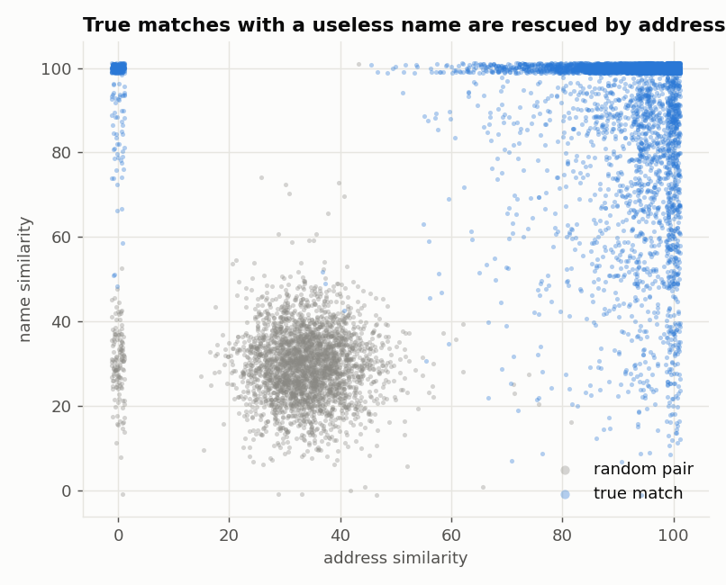
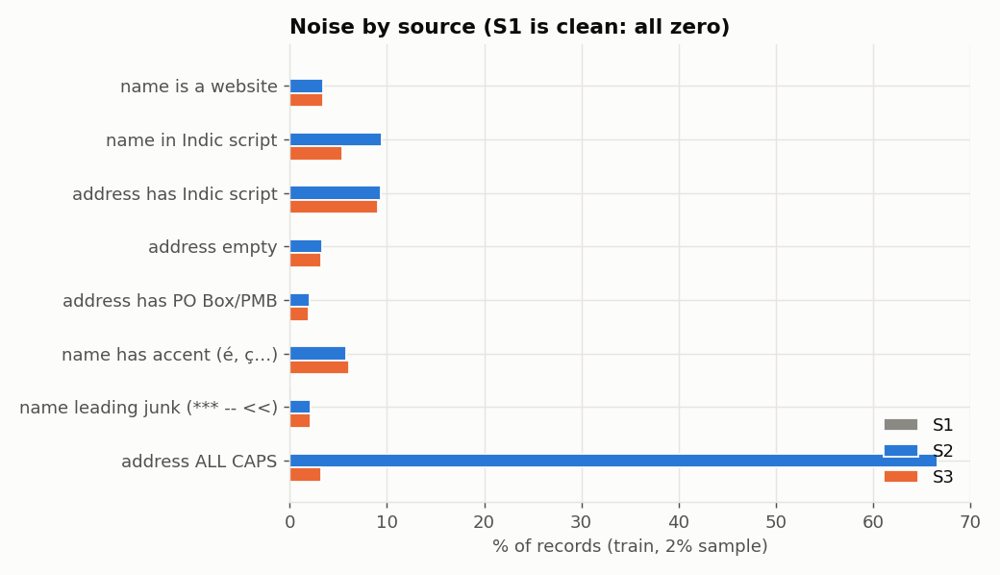

# Business Entity Resolution at Scale: Amazon ML Challenge 2026

**Team Game_Shift**: Sumit Barik (team leader), Shivanshu Vishwakarma, Sujal Verma


This is our solution to the **Amazon ML Challenge 2026 entity-resolution task**: link millions of noisy business records from two sources (S2, S3) to a clean reference registry (S1). The records span the **US, India and France**, and **France has no training labels at all**.

The pipeline is a cascade that narrows **~17 trillion possible pairs** to **4.5 candidates per entity** and then decides with fine-tuned multilingual cross-encoders and cluster-level reasoning. Final result: **macro F0.5 = 0.985594** on the public leaderboard (0.9901 on held-out validation), which placed the team in the **Top 1,000**.

---

## Highlights

- **Cascade built for scale.** Normalisation, then per-country TF-IDF and exact-key blocking (116 candidates per S1), then a 101-feature XGBoost filter (4.5 per S1, keeping 99.93% of true pairs), then a stacker over transformer rerankers.
- **Normalisation learned from the data itself:** a transliteration map (Indic → Latin) from training pairs, Viterbi name segmentation, consonant skeletons, and a department → region map for France learned **without labels**.
- **Multilingual cross-encoders** (`multilingual-e5-small` / `-base`, MIT) fine-tuned on 2 × T4 GPUs, including a round trained on **hard negatives mined by stage 1**.
- **Collective, cross-source matching:** stage 2 sees what the other records say about the same S1 entity, including S2 ↔ S3 agreement.
- **A country without labels (France)** handled by self-training, rerankers adapted on French pseudo-labels, and a **conservative model stack**. Each step was validated by treating a labelled country as unseen.
- **Label-free test-shift analysis:** comparing link rates per entity on test vs validation exposed *engineered decoys* (near-twin businesses) that validation under-samples. Correcting for them was the largest single leaderboard gain.

## The data

<p align="center">
  
  
</p>

- **Names are not identifiers:** 49.5% of S1 entities share their exact normalised name with another entity (largest group: 556). The **address has to carry the match** (left).
- **S1 is clean; S2/S3 carry the noise** (right): Indic scripts, website names, leetspeak, accents, junk tags, reordered or truncated addresses, and damaged house numbers (11% of US and 23% of Indian true pairs).
- **The test set is harder than training:** about 2× the distractors, many of them **hard negatives built from real entities**: same name with another house number, same address with one name word swapped.

## Pipeline

```mermaid
flowchart LR
    A[Raw S1 / S2 / S3<br/>records] --> B[Normalise<br/>translit · segmentation<br/>admin-area map]
    B --> C[Blocking per country<br/>3 TF-IDF views + exact keys<br/>+ char-3gram second pass]
    C -->|116 cand / S1| D[Stage 1: XGBoost filter<br/>101 features, p ≥ 0.01]
    D -->|4.5 cand / S1| E[Cross-encoders<br/>e5-small · e5-base · v3]
    D --> F[Stage 2 stacker<br/>cluster context · cross-source<br/>pairwise evidence]
    E --> F
    F --> G[Best S1 per record<br/>threshold t]
    G --> H[Test-shift correction<br/>near-twin decoys]
    H --> I[France: self-training<br/>adapted rerankers · model stack]
    I --> J[matching_results.tsv]
```



| Stage | What it does | Output |
|---|---|---|
| Normalisation | Unicode folding, learned transliteration, leetspeak repair, legal-form canonicalisation, name segmentation, admin-area map | `cache/{split}_s{1,2,3}.parquet` |
| Blocking | Per-country TF-IDF top-k (words, skeletons, number × word), exact keys (compact / sorted name, name + house number), second pass for weak records | ~200M pairs (115.7 per S1), recall 0.984 |
| Stage 1 | XGBoost on 101 name / address / house-number / TF-IDF / context features | 7.88M pairs (4.55 per S1) = `candidate_pairs.tsv` |
| Rerankers | Fine-tuned multilingual cross-encoders on `"name \| address"` pairs; France-adapted variants | per-pair logits |
| Stage 2 | Out-of-fold XGBoost stacker: stage-1 evidence, reranker scores, cluster and cross-source features | per-pair probability |
| Decision | Each record goes to its best S1 if p ≥ t (t tuned on the official macro F0.5) | `matching_results.tsv` |

## Results

| Version | Key change | Validation F0.5 | Public LB |
|---|---|---|---|
| v3 | ambiguity and house-number features | 0.9788 | 0.962 |
| v5 | segmentation, name + number key, XGBoost | 0.9822 | 0.968 |
| v6 | stage 2 (collective + e5-small reranker), admin map | 0.9883 | 0.9815 |
| v9 | complete-context stage 2, e5-base, second pass, unseen-mode stage 2 for France | 0.98938 | 0.982177 |
| v10c | France self-training, reranker v3 (stage-1 hard negatives), fuzzy name-group retrieval | 0.99011 | 0.983825 |
| v11a | test-shift correction of US near-twin decoys | (unchanged by design) | 0.985128 |
| v15 | France on adapted rerankers; decoy-fingerprint cells for US/India | (unchanged by design) | 0.985345 |
| **v18** | **France model stack (A + B, changes confirmed by a no-house-number model C)** | – | **0.985594** |

The leaderboard decomposes by country share, LB ≈ 0.85 · F(US + India) + 0.15 · F(France). After the test-shift correction, US/India on test (~0.990) matches validation. France, with no labels, is where the remaining gap lies.

### Validating a country with no labels

Each labelled country was treated in turn as unseen:

| Unseen country | Stage 1 from the other country only | + unseen-mode stage 2 | + self-training |
|---|---|---|---|
| India | 0.93250 | 0.98540 | **0.98723** |
| US | 0.97191 | 0.98862 | **0.98904** |

Feature-group ablations on unseen countries showed that **house-number features transfer worst**: removing them improves US → India by +0.0068. That result became model C of the final France stack ([`experiments/feature_ablation`](experiments/feature_ablation)).

## Repository structure

```
.
├── src/                        # the full pipeline (run every script from here)
│   ├── normalize.py, prepare.py, learn_translit.py, learn_admin_map.py, build_vocab.py
│   ├── blocking.py, run_blocking.py, second_pass.py, name_group_pass.py, fuzzy_group_pass.py
│   ├── features_v5.py, train_v5.py, predict_v5.py           # stage 1
│   ├── collective.py, stage2_plus.py, final_build_v10.py    # stage 2 + base submission
│   ├── loco.py, st_loco.py, france_st.py, france_variant.py # unseen countries / self-training
│   ├── cell_shift.py, apply_cells.py, patch_*.py            # test-shift corrections
│   ├── stack_france.py, export_stack_inputs.py              # final France stack
│   ├── reranker/                                            # cross-encoder training (Kaggle 2×T4 notebooks, DDP)
│   ├── resources/                                           # maps and link lists learned from the provided data
│   └── quick_validate.py, metrics.py                        # low-memory validator, official macro F0.5
├── eda/                        # exploratory analysis scripts, text reports and figures
├── experiments/feature_ablation/  # stage-1 feature-group ablations (in-country and unseen-country)
├── docs/
│   ├── METHODOLOGY.md          # full write-up: analysis, blocking, models, results, error analysis
│   ├── REPRODUCE.md            # exact end-to-end commands (steps 1–11)
│   └── EXPERIMENT_LOG.md       # version-by-version log with leaderboard scores
└── requirements.txt
```

## Getting started

```bash
git clone https://github.com/<your-username>/amazon-ml-challenge-2026-entity-resolution.git
cd amazon-ml-challenge-2026-entity-resolution
pip install -r requirements.txt          # Python 3.10; a CUDA GPU is recommended for XGBoost and the rerankers
```

The competition data is **not included**. Place it at `student_resource/dataset/{train,test}/`, or point `ER_DATA` to it. Intermediate files go to `cache/` (`ER_CACHE`) and submissions to `output/` (`ER_OUTPUT`).

```bash
cd src
export ER_BLOCK_K="word=10,skel=5,numword=3" ER_CAND_TAG=_v6 ER_RUN=v6 PYTHONIOENCODING=utf-8
python prepare.py train test        # normalise the six source files
python run_blocking.py train        # candidate generation
python train_v5.py 0.12             # stage-1 model + validation F0.5
# ... full sequence (second pass, rerankers, stage 2, France, corrections) in docs/REPRODUCE.md
```

**Hardware used:** laptops with 16 GB RAM and 4–6 GB NVIDIA GPUs for everything except training the large rerankers, which ran on Kaggle **2 × T4** (`src/reranker/*.ipynb`). Run heavy steps one at a time on 16 GB machines.

## Models and data policy

- XGBoost (Apache-2.0); `intfloat/multilingual-e5-small` (118M) and `intfloat/multilingual-e5-base` (278M), both MIT.
- **No external data, APIs or geocoding.** Every learned resource (transliteration map, name vocabulary, admin-area map, pseudo-labels, link lists) comes from the provided files.
- Explored and dropped: `BAAI/bge-reranker-v2-m3`, frozen and LoRA-tuned Qwen2.5-0.5B (weaker than e5 on the unseen-country simulation). Details in [`docs/METHODOLOGY.md`](docs/METHODOLOGY.md).

## Documentation

- [**Methodology**](docs/METHODOLOGY.md): problem analysis, blocking, both stages, the rerankers, unseen-country handling, the test-shift corrections, error analysis.
- [**Reproduction guide**](docs/REPRODUCE.md): every command, environment variable and intermediate file.
- [**Experiment log**](docs/EXPERIMENT_LOG.md): what was tried, what worked and what didn't, with scores.

## Acknowledgements

Built for the Amazon ML Challenge 2026. Thanks to the organisers for a well-designed, genuinely hard entity-resolution benchmark.
